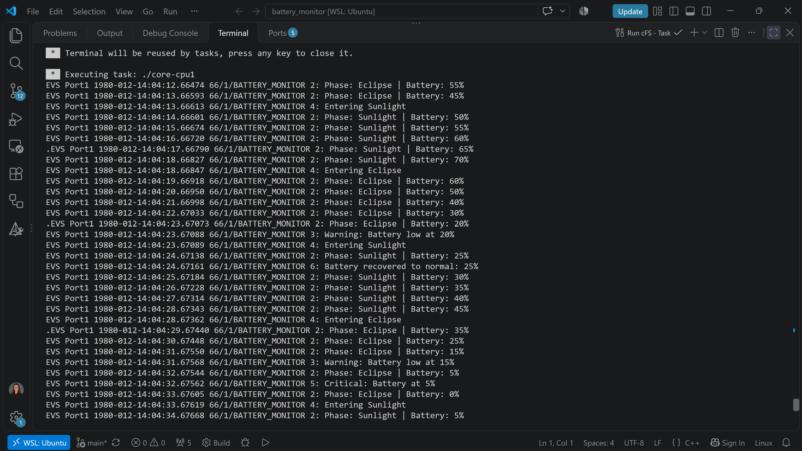
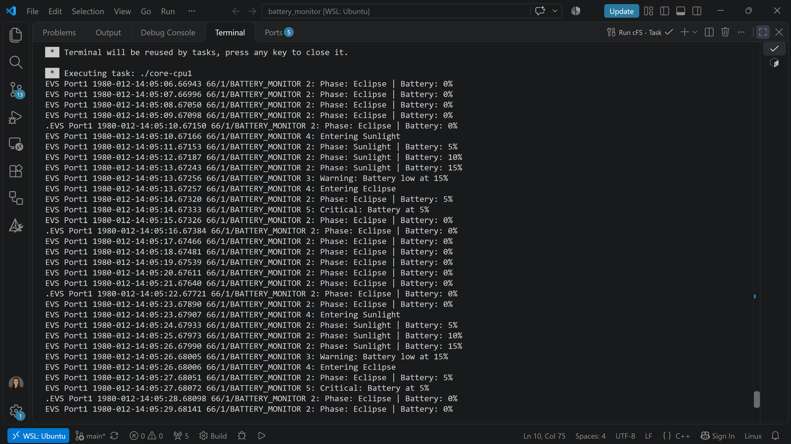
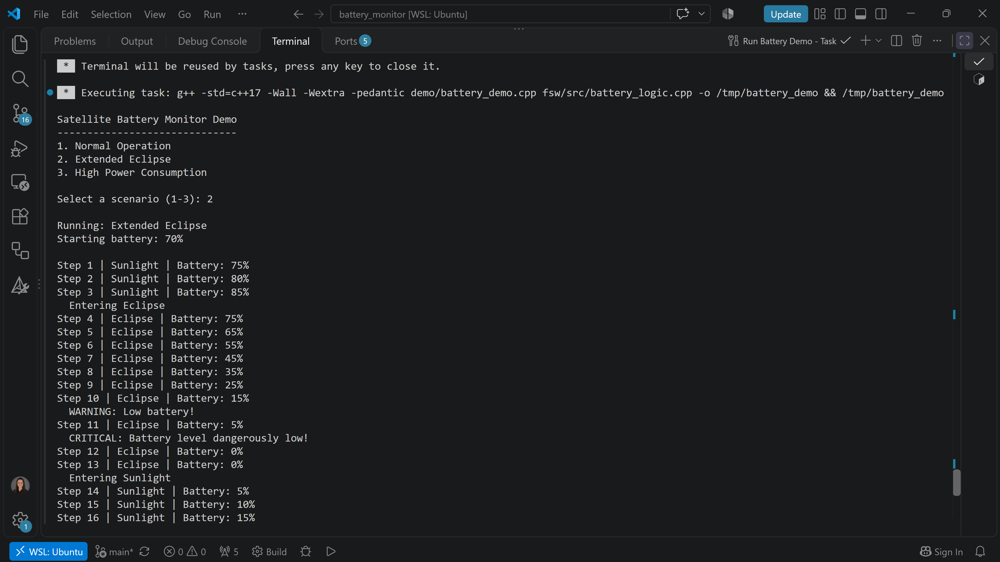

# cFS Satellite Battery Monitor

A C++17 battery simulation built for NASA's Core Flight System (cFS). The application tracks battery levels during sunlight and eclipse periods and logs charging, discharging, and low-battery events.

The repository also includes a standalone C++ demo that runs without cFS and automated tests for the shared simulation logic.

## Project Motivation

Growing up on Florida's Space Coast instilled in me a sense of pride and appreciation for the space industry and the engineering behind it. This project was an opportunity to explore spacecraft software development while applying my experience in C++ programming, simulation, and software testing.

## Features

- Simulated charging and discharging during sunlight and eclipse periods
- Three configurable operating scenarios
- Low-battery warning at 20% and critical status at 10%
- Battery values limited to 0–100%
- Event logging through cFS Event Services
- Scenario selection without changing C++ source code
- Standalone demo, unit tests, and GitHub Actions testing

## Simulation Scenarios

All scenarios start at 70% battery capacity.

| Scenario | Charging | Discharging | Sunlight | Eclipse |
|---|---|---|---|---|
| Normal Operation | +5%/step | -10%/step | 5 steps | 5 steps |
| Extended Eclipse | +5%/step | -10%/step | 3 steps | 10 steps |
| High Power Consumption | +2%/step | -15%/step | 5 steps | 5 steps |

These are predefined simulation values, not actual spacecraft power measurements.

## Screenshots

**Normal Operation**



**Extended Eclipse**



**High Power Consumption**


**Standalone Demo**



## Running the Standalone Demo

Requires a C++17-compatible compiler such as G++.

From the project directory:

```bash
g++ -std=c++17 \
  demo/battery_demo.cpp \
  fsw/src/battery_logic.cpp \
  -o battery_demo

./battery_demo
```

The demo prompts you to select Normal Operation, Extended Eclipse, or High Power Consumption. It runs for 40 simulation steps and displays battery levels, phase transitions, and status changes.

In VS Code, the same demo can be launched with **Terminal > Run Task > Run Battery Demo**.

## Running with NASA cFS

The cFS application was developed and tested using Ubuntu through WSL. NASA cFS must be installed separately.

The configuration below is based on the [NASA cFS sample mission](https://github.com/nasa/cFS).

### Setup

1. Install and configure NASA cFS following its repository instructions.
2. Copy or link the `battery_monitor` project directory into `cFS/apps`.
3. Add the application to `sample_defs/targets.cmake`:

```cmake
list(APPEND MISSION_GLOBAL_APPLIST battery_monitor)
```

4. Register the application in `sample_defs/generate_startup.cmake`:

```cmake
"CFE_APP, battery_monitor, BATMON_Main, BATTERY_MONITOR, 85, 16384, 0x0, 0;\n"
```

5. In `sample_defs/arch_build_custom.cmake`, scope the existing C99 compiler flag to C files:

```cmake
$<$<COMPILE_LANGUAGE:C>:-std=c99>
```

### Build and Run

From the main cFS directory:

```bash
make native_std.prep
make native_std.install
```

Launch cFS from its runtime directory:

```bash
cd build-native_std/exe/cpu1
./core-cpu1
```

For manual execution, copy `config/scenario.cfg` into the runtime `cpu1/cf` directory before launching.

### VS Code Tasks

The included tasks assume NASA cFS is installed at `~/cFS` and VS Code is running in WSL.

- **Configure cFS** — prepares the native build
- **Build cFS** — compiles and installs the application
- **Run cFS** — prompts for a simulation scenario
- **Run cFS (Config File)** — uses `config/scenario.cfg`
- **Run Battery Demo** — builds and starts the standalone program
- **Test Battery** — compiles and runs battery logic tests

Scenario selection does not require rebuilding the C++ application.

## Configuration

The cFS application reads its scenario from `scenario.cfg` at startup. Available values are `scenario=1` for Normal Operation, `scenario=2` for Extended Eclipse, and `scenario=3` for High Power Consumption.

An invalid or missing configuration falls back to Normal Operation and logs a message.

The standalone demo uses its own menu rather than the configuration file.

## Testing

Unit tests for the shared simulation logic are located in `tests/battery_test.cpp`.

Run them in VS Code using **Terminal > Run Task > Test Battery**, or compile and run them directly:

```bash
g++ -std=c++17 -Wall -Wextra -pedantic \
  tests/battery_test.cpp \
  fsw/src/battery_logic.cpp \
  -o battery_test

./battery_test
```

GitHub Actions runs the standalone C++ tests and checks scenario selection and invalid-input handling on pushes and pull requests.

The cFS application and all three scenarios have also been tested locally in WSL. The GitHub Actions workflow does not build the complete NASA cFS environment.

## Technologies

C++17 · NASA cFS/OSAL · CMake · GCC/G++ · Ubuntu/WSL · VS Code · GitHub Actions

## Acknowledgments

This project uses NASA's open-source [Core Flight System (cFS)](https://github.com/nasa/cFS) as its flight software framework. The official cFS documentation and sample mission served as references for application integration and configuration.

## Project Scope and Disclaimer

This independently developed software simulation is intended for educational and experimental purposes. It does not use physical battery hardware, satellite telemetry, or a detailed spacecraft power model.

This project is not affiliated with, sponsored by, or endorsed by NASA and is not intended for operational spacecraft deployment.