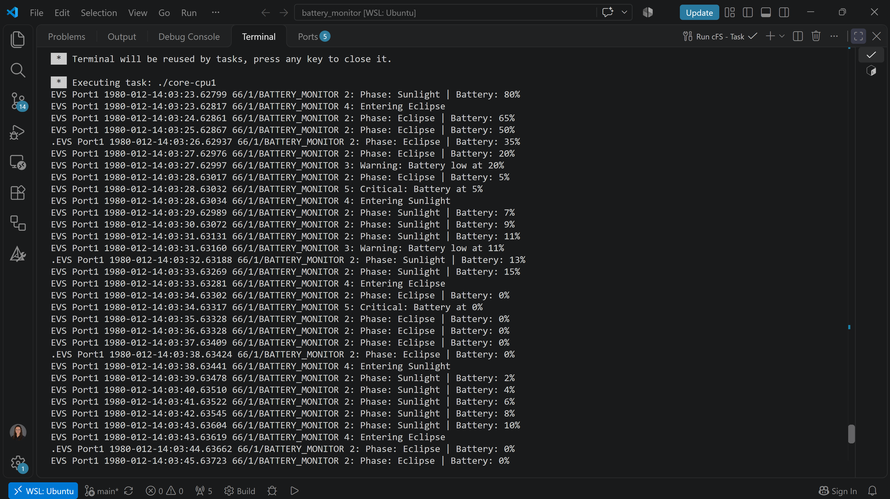

# cFS Satellite Battery Monitor

A C++17 application that simulates satellite battery charging and discharging using NASA's Core Flight System (cFS).

The project includes a cFS application and a standalone C++ demo that runs without installing cFS. Both use the same battery simulation logic.

## About

I built this project to practice C++ and learn how to develop an application within NASA's cFS framework.

The simulation tracks battery levels during sunlight and eclipse periods, reports low-battery conditions, and detects when the battery recovers. I also used the project to get more experience with Linux, CMake, testing, and GitHub Actions.

## Features

- Simulates charging and discharging during sunlight and eclipse periods
- Keeps battery levels between 0% and 100%
- Supports three simulation scenarios
- Reports low-battery warnings at 20% and critical conditions at 10%
- Uses cFS Event Services to log battery levels and status changes
- Allows scenario selection without modifying C++ code
- Includes a standalone C++ demo and battery logic tests

## Simulation Scenarios

| Scenario | Starting Battery | Charge Rate | Discharge Rate | Sunlight | Eclipse |
|---|---|---|---|---|---|
| Normal Operation | 70% | +5% | -10% | 5 steps | 5 steps |
| Extended Eclipse | 70% | +5% | -10% | 3 steps | 10 steps |
| High Power Consumption | 70% | +2% | -15% | 5 steps | 5 steps |

The rates and durations are predefined for the simulation and do not represent actual satellite measurements.

## Screenshots

### Normal Operation


### Extended Eclipse


### High Power Consumption



### Standalone C++ Demo


## Technologies

- C++17
- NASA cFS and OSAL
- CMake
- GCC/G++
- Linux (Ubuntu/WSL)
- VS Code
- GitHub Actions

## Standalone Demo

The standalone demo runs the battery simulation independently of NASA cFS. It allows users to select one of the three scenarios and displays 40 simulation steps.

To compile and run it from the project folder:

```bash
g++ -std=c++17 demo/battery_demo.cpp fsw/src/battery_logic.cpp -o battery_demo
./battery_demo
```

Select a scenario when prompted:

```text
1. Normal Operation
2. Extended Eclipse
3. High Power Consumption
```

The program displays battery levels, sunlight/eclipse phases, and status changes. Invalid selections are rejected.

**VS Code:** Open the project in WSL and select **Terminal > Run Task > Run Battery Demo**.

## Running with NASA cFS

NASA cFS must be installed separately. I developed and tested this application using Ubuntu through WSL.

The following setup is based on the cFS sample mission used during development. Other cFS versions may require different configuration steps.

### Setup

1. Download and configure [NASA cFS](https://github.com/nasa/cFS) using its installation instructions.
2. Copy or link the `battery_monitor` folder into `cFS/apps`.
3. Add `battery_monitor` to the mission application list in `sample_defs/targets.cmake`.
4. Register `BATMON_Main` in the mission startup configuration.
5. Make sure the build configuration supports C++ source files.

For the sample mission used in this project, I added:

**`sample_defs/targets.cmake`**

```cmake
list(APPEND MISSION_GLOBAL_APPLIST battery_monitor)
```

**`sample_defs/generate_startup.cmake`**

```cmake
"CFE_APP, battery_monitor, BATMON_Main, BATTERY_MONITOR, 85, 16384, 0x0, 0;\n"
```

I also updated `sample_defs/arch_build_custom.cmake` so its `-std=c99` option applies only to C files:

```cmake
$<$<COMPILE_LANGUAGE:C>:-std=c99>
```

### Build and Run

From the main cFS directory:

```bash
make native_std.prep
make native_std.install
```

Then run:

```bash
cd build-native_std/exe/cpu1
./core-cpu1
```

For the manual method, copy `config/scenario.cfg` into the runtime `cpu1/cf` folder before launching cFS.

### Running in VS Code

The included VS Code tasks expect cFS to be installed at `~/cFS`.

1. Open the `battery_monitor` folder in VS Code using WSL.
2. Select **Terminal > Run Task > Build cFS**.
3. Select **Terminal > Run Task > Run cFS**.
4. Choose Normal Operation, Extended Eclipse, or High Power Consumption.

The selected scenario is saved to the cFS runtime configuration file automatically.

You can also use **Run cFS (Config File)** to run the scenario specified in `config/scenario.cfg`.

Changing scenarios does not require rebuilding. After editing C++ source files or build settings, run **Build cFS** again.

## Testing

Battery logic tests are included in `tests/battery_test.cpp`.

To compile and run them:

```bash
g++ -std=c++17 -Wall -Wextra -pedantic tests/battery_test.cpp fsw/src/battery_logic.cpp -o battery_test
./battery_test
```

You can also select **Terminal > Run Task > Test Battery** in VS Code.

GitHub Actions runs the standalone C++ tests and checks the demo's scenario selections and invalid-input handling on pushes and pull requests.

The automated workflow tests the standalone components, not the complete cFS environment.

## Notes

- This is a battery monitoring simulation, not a physical spacecraft power model.
- No real satellite hardware or telemetry is used.
- NASA cFS is a separate dependency and requires additional setup.
- The cFS version was developed using Ubuntu through WSL.
- The standalone demo can be compiled and run without NASA cFS.